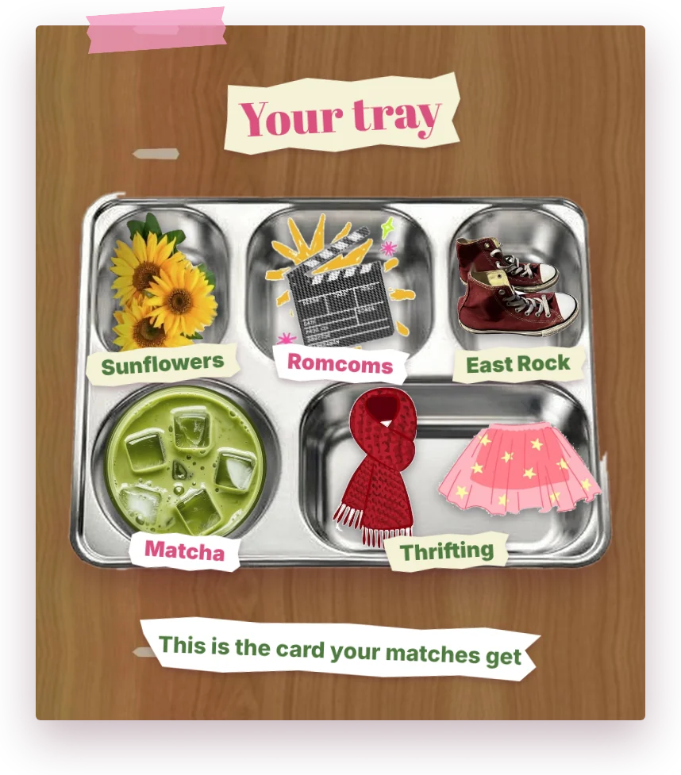
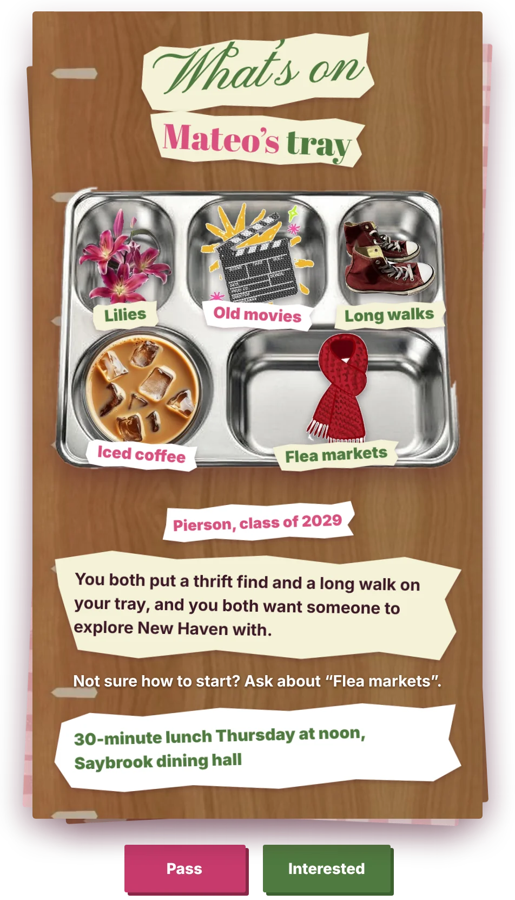
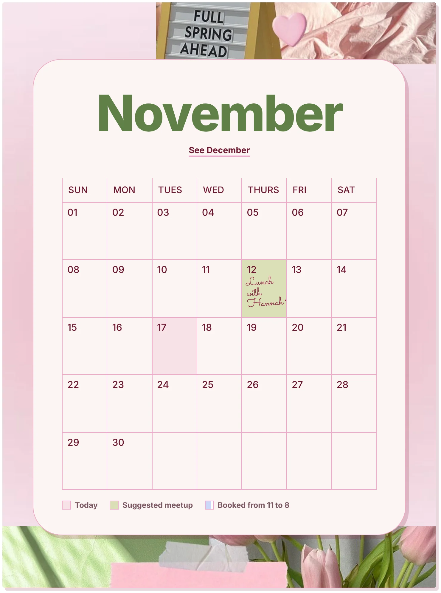
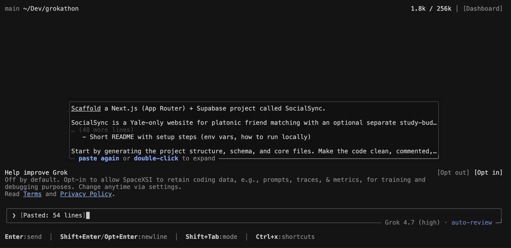

<p align="center">
  &nbsp;
  <i>one meal a week with someone new</i>
  &nbsp;
</p>

## Demo Video




Instead of a profile, you get a lunch tray.

Put your first name on it and five things you like. A thing can be a photo you upload, an emoji with a label, or one of the cut-outs (there's a scarf, a pair of sneakers and some sunflowers to start you off). The round well is for your drink.

That's the whole card. Nobody sees it until you've been matched with them.

<br clear="all">




Every Sunday at 8pm you get up to three trays.

Each one comes with a line on why we put you two together. If you've both added a calendar, lunch is already picked: a day, a time and a dining hall.

Drag the card right if you're in, left to pass. They only find out if you both say interested, and that's when chat opens.

The matching comes from a short questionnaire you fill out when you sign up. Your answers never show up on your card.

<br clear="all">




Paste your Google Calendar's secret iCal address, or upload an `.ics` file.

We keep when you're busy and nothing else. Event names are dropped the moment you import.

On Sunday the match job looks for the first hour that week when you're both free. It tries lunch first and falls back to dinner. Then it writes that time and a dining hall onto the match, which is all the other person ever sees of your schedule.

It's a one-time copy, so import again when your week changes.

<br clear="all">


Optional. Opt in and you get a second list next to your friend matches, made up only of other people who opted in.


- Someone you're matched with sees your first name, college, class year and tray.
- Nobody sees your email. The UI doesn't show it anywhere.
- Nobody sees your questionnaire answers. The match job is the only thing that reads them.
- Only you can read your calendar.
- Sign-up is `@yale.edu` only.


Go to `/demo` on any deployment. It has sample people and a sample class schedule, and you can swipe trays, say you're in, chat, edit a tray and import a calendar. It needs no account and never touches the database.

Two things exist only in the demo for now: the confirm-by deadline, and the "would you get a meal with them again?" question.


Built with Next.js 16 (App Router, TypeScript, Cache Components), Supabase (Auth, Postgres, Realtime) and Tailwind CSS.

1. Create a Supabase project.
2. In the SQL editor, run [`supabase/schema.sql`](supabase/schema.sql) once, then [`supabase/migrations/001_trays_and_calendar.sql`](supabase/migrations/001_trays_and_calendar.sql). The second one is safe to run again. If you skip it the app still works, but trays show up empty and no plans are suggested.
3. In Authentication → Providers, enable Email. For local testing you can turn off "Confirm email".
4. In Authentication → URL configuration, set the site URL to `http://localhost:3000` and add `http://localhost:3000/auth/callback` to the redirect allow list.
5. Copy `.env.example` to `.env.local` and fill in the project URL, publishable key, secret key and `CRON_SECRET`.
6. Install and run:

```bash
npm install
npm run dev
```

Then open http://localhost:3000.

Set the `NEXT_PUBLIC_*` values before you run `npm run dev` or `npm run build`. Next inlines them, so a build made without them keeps acting like Supabase isn't set up. Restart the dev server after you change `.env.local`.

### The Sunday job

```bash
curl -X POST http://localhost:3000/api/cron/matches \
  -H "Authorization: Bearer $CRON_SECRET"
```

Point a scheduler at that URL for Sundays at 8:00pm America/New_York. The matches it writes are for the week that starts the next morning. `GET` works too, for schedulers that can't `POST`. The secret stays in the header.

Each person gets up to three friend matches. Running the job again for the same week doesn't reset anyone's answer or their chat.

Scoring is in [`lib/matching.ts`](lib/matching.ts): `scoreFriendMatch`, `scoreStudyMatch` and `generateWeeklyMatches`. The cron route calls the generator with the service-role key, which bypasses row-level security.

<details>
<summary>Project map</summary>

```
app/
  page.tsx                 Login and signup
  questionnaire/page.tsx   Multi-step form
  matches/page.tsx         Trays to swipe, friends and study-buddy tabs
  tray/page.tsx            Edit your own tray
  calendar/page.tsx        Calendar import and the month view
  chat/[matchId]/page.tsx  On-site messages
  auth/callback/route.ts   Magic-link return
  api/cron/matches/route.ts
  actions/                 Auth, questionnaire, interest, messages
components/                Forms, match board, chat
lib/
  matching.ts              Scores and weekly generation
  ics.ts, plan.ts          Calendar parsing, free time, suggested plan
  questionnaire.ts         Answer validation
  auth.ts                  Current user
  supabase/                Browser, server, and service-role clients
proxy.ts                   Refreshes the Supabase session
public/collage/            Tray, drinks, backgrounds and paper pieces
supabase/schema.sql
supabase/migrations/
```

</details>

<details>
<summary>A few notes on how it's built</summary>

Trays are stored on `users.tray` and saved through the `save_tray` database function, so college, class year and email can't be changed from the browser. A database trigger stores residential college and class year at sign-up and rejects anything else.

Busy times live in `calendars`, which only the owner can read. The weekly job reads both calendars with the service role.

A match is one row shared by the pair. `user_response` and `matched_response` sit beside `status` so each person can decide on their own. One status column can't hold both decisions, and chat needs a single match id.

Chat unlocks when both responses are `interested` and `status` is `mutual`. The thread uses Supabase Realtime and also polls every few seconds, so it still updates if replication is off. The schema adds `messages` to the realtime publication.

</details>

## Grok screenshot



## video

https://github.com/user-attachments/assets/0368ffac-005e-4d1f-b808-2f6fb7a3c4ff

<p align="center">
  <br>
  <sub>The tray photo, drinks, backgrounds and paper pieces in <code>public/collage</code> come from Sofia's own graphics.</sub>
</p>
