# Busy Bees

Friend matching for Yale students, with an optional study-buddy list. Everyone fills a lunch tray with five things. Every Sunday at 8pm you get a few trays to swipe through, each with a 30-minute dining hall lunch at a time you're both free (if you've both imported a calendar). Chat opens only after both people tap Interested.


# Busy Bees


## Stack

- Next.js 16 (App Router, TypeScript, Cache Components)
- Supabase Auth, Postgres, and Realtime
- Tailwind CSS

## Setup

1. Create a Supabase project.
2. In the SQL editor, run [`supabase/schema.sql`](supabase/schema.sql) once, then [`supabase/migrations/001_trays_and_calendar.sql`](supabase/migrations/001_trays_and_calendar.sql) and [`supabase/migrations/002_match_availability.sql`](supabase/migrations/002_match_availability.sql). The second file adds trays, imported calendars and the suggested plan on a match. The third lets a match see the hours you're both free. Both are safe to run again. Until the second has been run the app still works, but trays show up empty and no plans are suggested.
3. In Authentication → Providers, enable Email. For local testing you can turn off “Confirm email”.
4. In Authentication → URL configuration, set the site URL to `http://localhost:3000` and add `http://localhost:3000/auth/callback` to the redirect allow list.
5. Copy `.env.example` to `.env.local` and fill in the project URL, publishable key, secret key, and `CRON_SECRET`.
6. Install and run:

```bash
npm install
npm run dev
```

Open [http://localhost:3000](http://localhost:3000). Sign-up accepts `@yale.edu` only. The database trigger stores residential college and class year and rejects anything else.

Set the `NEXT_PUBLIC_*` values before `npm run dev` or `npm run build`. Next inlines them, so a build made without them will keep treating Supabase as unconfigured. Restart the dev server after changing `.env.local`.

## Weekly matches

Friend scores live in [`lib/matching.ts`](lib/matching.ts): `scoreFriendMatch`, `scoreStudyMatch`, and `generateWeeklyMatches`. The cron route calls the generator with the service-role key, which bypasses row-level security. Running it again for the same week does not reset interest or chat.

```bash
curl -X POST http://localhost:3000/api/cron/matches \
  -H "Authorization: Bearer $CRON_SECRET"
```

Point a scheduler at that URL for Sundays at 8:00pm America/New_York. The matches it writes are for the week that starts the next morning. `GET` works too, for schedulers that cannot POST. The secret stays in the header.

Each person can receive up to three friend matches. Study matches are a separate list and only include students who opted in.

## Trays

A tray is a first name plus five things: a label with an emoji, a photo you upload, or one of the ready-made cut-outs in `public/collage` (the round well is for your drink). Trays are stored on `users.tray` and saved through the `save_tray` database function, so college, class year and email can't be changed from the browser. Someone can see your tray only once you've been matched with them.

## Calendar

On the Calendar page you paste your Google Calendar's secret iCal address, or upload an `.ics` file. It's a one-time copy: import again to refresh it. Only the busy times are stored (event names are dropped on import), in `calendars`, which only the owner can read directly. The weekly match job reads both calendars with the service role, finds the first hour you're both free that week, and writes only that time and a place onto the match. On an open match, `match_availability` also shows the next seven days of free hours to the two of you: the overlap, your hours, and theirs. A closed match sees none of it.

## Demo

`/demo` walks through the whole thing with sample people and a sample class schedule: swipe trays, say you're in, chat, edit a tray, import a calendar. It needs no accounts and never touches the database, so it works on any deployment. The confirm-by deadline and the "would you get a meal with them again?" question exist only there for now.

## Chat

A match row is shared by the pair. Chat unlocks when both responses are `interested` and `status` is `mutual`. The thread uses Supabase Realtime and polls every few seconds so it still updates if replication is off. The schema adds `messages` to the realtime publication.

## Project map

```
app/
  page.tsx                 Login and signup
  questionnaire/page.tsx   Multi-step form
  matches/page.tsx         Trays to swipe, friends and study-buddy tabs
  tray/page.tsx            Edit your own tray
  calendar/page.tsx        Calendar import and the month view
  chat/[matchId]/page.tsx  On-site messages
  auth/callback/route.ts   Magic-link return
  api/cron/matches/route.ts
  actions/                 Auth, questionnaire, interest, messages
components/                Forms, match board, chat
lib/
  matching.ts              Scores and weekly generation
  ics.ts, plan.ts          Calendar parsing, free time, suggested plan
  questionnaire.ts         Answer validation
  auth.ts                  Current user
  supabase/                Browser, server, and service-role clients
proxy.ts                   Refreshes the Supabase session
public/collage/            Tray, drinks, backgrounds and paper pieces
supabase/schema.sql
supabase/migrations/
```

## grok screenshot


## Notes

- Prompts are saved on the questionnaire and are not shown to a match. The card uses the generated “why you matched” line.
- Questionnaires are private. The match job is the only reader of other people’s answers.
- Someone you are already matched with can see your first name, college, class year and tray. The UI does not show email.
- The tray photo, drinks, backgrounds and paper pieces in `public/collage` come from Sofia's own graphics.
- `user_response` and `matched_response` sit beside `status` so each person can decide independently. One status column cannot store both decisions, and chat needs a single match id.
